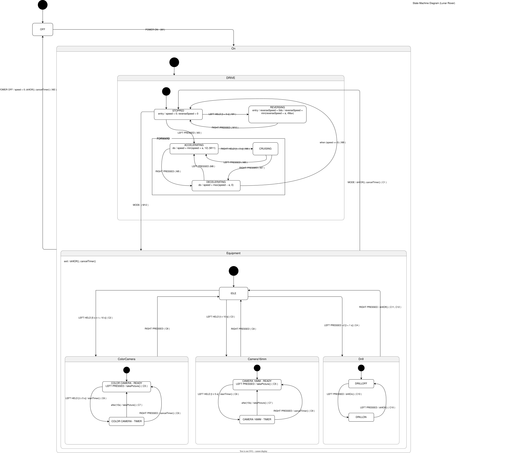

# Lunar Rover: State Machine Project

A simple Java (NetBeans) project that turns the Lunar Rover UML state machine into code. There are 7 files (one class each). `ASSIGNMENT03LUNARROVERSYSTEM.java` is the main class: you type pedal and button actions, and the rover reacts. The rover keeps its own clock, so speed changes and the selfie timer run by themselves. No lists or queues are used.

## State Machine Diagram

 

## Project Structure

```
ASSIGNMENT-03-LUNAR-ROVER-SYSTEM/
└── src/
    └── assignment03lunarroversystem/
        ├── ASSIGNMENT03LUNARROVERSYSTEM.java (Main Class)
        ├── LunarRover.java
        ├── State.java
        ├── RoverSettings.java
        ├── RoverClock.java
        ├── RoverGuide.java
        └── RoverTests.java
```

| File | What it does |
|---|---|
| ASSIGNMENT03LUNARROVERSYSTEM.java | The console. Reads what you type and shows the guide after every input. |
| LunarRover.java | The state machine. Every transition (M1 to M12, C1 to C12) is written here. |
| State.java | The list of states from the diagram. |
| RoverSettings.java | All the numbers: speeds, hold times, selfie delay, tick length. |
| RoverClock.java | The automatic clock that ticks once a second. |
| RoverGuide.java | The "next moves" list and the map of the whole diagram. |
| RoverTests.java | 41 built-in checks that replay the sample scenarios. |

## Nested States

```
OFF
ON
├── DRIVE
│   ├── STOPPED
│   ├── FORWARD
│   │   ├── ACCELERATING
│   │   ├── CRUISING
│   │   └── DECELERATING
│   └── REVERSING
└── EQUIPMENT
    ├── IDLE
    ├── COLOR CAMERA   (READY, TIMER)
    ├── CAMERA 16MM    (READY, TIMER)
    └── DRILL          (DRILL OFF, DRILL ON)
```

The rover always sits in one innermost state. Rules that belong to a bigger state apply to everything inside it: Power off (M2) works from every state, and the Mode switch (C1) works from every Equipment state.


## Settings

| Setting | Value | Meaning |
|---|---|---|
| MAX_FORWARD_SPEED | 12 km/h | Top speed from the assignment (M11) |
| MAX_REVERSE_SPEED | 6 km/h | Reverse limit, rMax (assumption) |
| SPEED_STEP | 1 km/h per second | Speed gained or lost each second |
| PRESS_LIMIT | 1 s | Released under this is a tap |
| DRIVE_HOLD | 3 s | Hold longer than this to reverse or cruise |
| COLOR_CAMERA_HOLD / CAMERA_16MM_HOLD | 5 s / 10 s | Hold times that select each camera |
| TIMER_HOLD | 5 s | Hold in a camera to start the selfie timer |
| SELFIE_DELAY | 10 s | Selfie countdown |
| TICK_MILLIS | 1000 ms | Real time between automatic ticks |

## Drive Mode Actions (M)

L is the left pedal and R is the right pedal. Items marked (added) are not in the original description.

| ID | Action |
|---|---|
| M1 | (added) Power button, from Off: the rover powers on and goes to STOPPED. |
| M2 | (added) Power button, from any state: the buggy stops, the drill is switched off, any timer is cancelled and the rover goes to OFF. |
| M3 | L tapped at rest: accelerate forward. |
| M4 | L held more than 3 s at rest: accelerate backward (REVERSING). |
| M5 | R tapped while accelerating: decelerate. |
| M6 | R held more than 3 s while accelerating: hold constant forward speed (CRUISING). |
| M7 | (added) R tapped while cruising: decelerate. |
| M8 | (added) L tapped while cruising or decelerating: accelerate forward again. |
| M9 | (added) Speed reaches 0 while decelerating: go to STOPPED. |
| M10 | (added) R tapped while reversing: stop (STOPPED). |
| M11 | (added) Forward speed stops increasing at 12 km/h. |
| M12 | (added) Mode switch while STOPPED: enter Equipment mode. |
| M13 | (added) Reverse speed stops increasing at the reverse limit. |
| M14 | (added) Mode switch while the rover is moving: ignored. |
| M15 | (added) Any pedal action not listed for the current Drive state: ignored. |

## Equipment Modes

| Mode | How to enter (from IDLE) | What it does | How to leave |
|---|---|---|---|
| IDLE | Mode switch from STOPPED | Waiting for a choice | Mode switch (back to Drive) |
| COLOR CAMERA | Hold L 5 s to under 10 s | READY: L tap takes a picture, L hold 5 s starts the selfie timer. TIMER: after 10 s the picture is taken. | R tap (to IDLE; in TIMER it cancels the timer first) |
| CAMERA 16MM | Hold L 10 s or more | Same as the color camera | Same as the color camera |
| DRILL | Tap L twice | Starts OFF. L tap switches it on or off. | R tap (drill stops, back to IDLE) |

## Equipment Mode Actions (C)

| ID | Action |
|---|---|
| C1 | (added) Mode switch in any Equipment state: drill off, timer cancelled, return to Drive mode (STOPPED). |
| C2 | L held 5 s in IDLE: select the color camera. |
| C3 | L held 10 s in IDLE: select the 16-mm camera. |
| C4 | L tapped twice in IDLE: select the drill (DRILL OFF). |
| C5 | L tapped in a camera (READY): take a picture. |
| C6 | L held 5 s in a camera (READY): start the selfie timer. |
| C7 | (added) Timer expires: take the picture and return to the camera (READY). |
| C8 | R tapped in a camera (READY): return to IDLE. |
| C9 | (added) R tapped in a TIMER state: cancel the timer and return to READY, no picture. |
| C10 | L tapped in the drill: switch between DRILL ON and DRILL OFF. |
| C11 | (added) R tapped in DRILL OFF: return to IDLE. |
| C12 | (added) R tapped in DRILL ON: stop the drill, then return to IDLE. |
| C13 | (added) R tapped in IDLE: no effect. |
| C14 | (added) L tapped or held in a TIMER state: ignored. |

## Assumptions

| ID | Assumption |
|---|---|
| A1 | Button 1 is Power and Button 2 is the Mode switch. |
| A2 | A tap is a pedal release within 1 s. A hold is a release after at least the time in its guard. A release that is neither (for example 2 s in Drive) does nothing. |
| A3 | A hold is judged when the pedal is released. In IDLE, 5 s to under 10 s selects the color camera and 10 s or more selects the 16-mm camera. |
| A4 | Safety interlock: the Mode switch only works while the buggy is STOPPED. |
| A5 | Leaving Equipment mode (Mode switch or Power off) turns the drill off and cancels any running timer without taking a picture. |
| A6 | Reverse is slower than forward, continues until R is tapped, and has no cruise mode. |
| A7 | The selfie timer counts down 10 s, then takes one picture automatically. |
| A8 | In every mode, R is a step back toward idle or a stop. |
| A9 | The rover starts in OFF. |
| A10 | Pedals and buttons are used one at a time. Each input is fully handled before the next. |
| A11 | A pedal action that triggers a transition is used up. Releasing the same pedal does not trigger a second one. |
| A12 | In Equipment mode the pedals never move the buggy. |
| A13 | In a TIMER state, R is handled by the innermost state first (C9). A second R tap in READY returns to IDLE (C8). |
| A14 | Entering Equipment mode always starts at IDLE, a camera at READY, the drill at DRILL OFF. No history is kept. |
| A15 | Cruising holds the speed reached when the hold finished and can only be entered from ACCELERATING. |
| A16 | Braking from REVERSING is immediate. |
| A17 | Both cameras behave the same. A picture captures one image or frame. |
| A18 | The drill switches on and off instantly. |
| A19 | Power off immediately stops the buggy. The next power on starts in STOPPED with both speeds at 0. |
| A20 | The Mode switch pressed while the rover is OFF does nothing. |
| A21 | A tap inside a camera's READY state takes a picture without leaving READY (an internal transition). |

## Methods

| Class | Methods |
|---|---|
| LunarRover | `powerButton()`, `modeButton()`, `leftReleased(seconds)`, `rightReleased(seconds)`, `leftPressedTwice()` |
| LunarRover | `tick()`, `tick(seconds)`, `autoTick()` (called by the clock) |
| LunarRover | `status()`, `guide()`, `getState()`, `getSpeed()`, `getReverseSpeed()`, `getPictures()` |
| RoverClock | `start()` (also resumes), `pause()` |
| RoverGuide | `nextMoves(state)` |
| RoverTests | `runTests()` |
